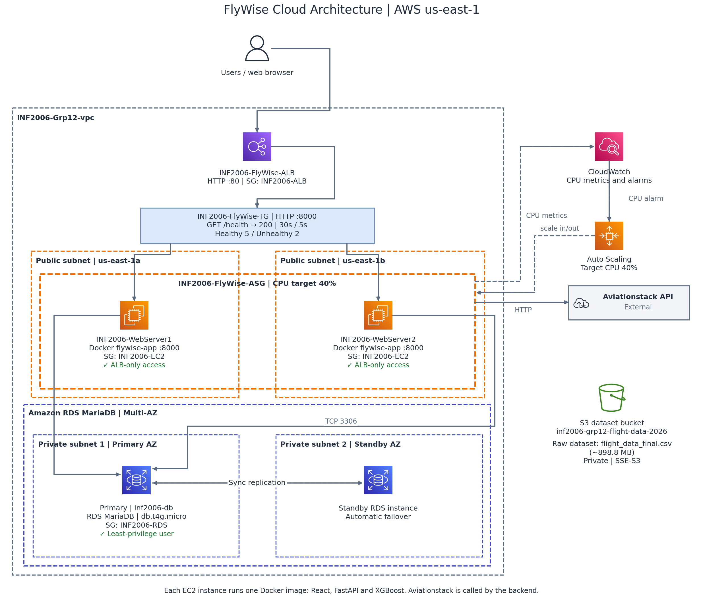

# FlyWise

**INF2006 Group 12 — Flight Delay Analytics and Prediction Platform**

**FlyWise:** http://inf2006-flywise-alb-1672116072.us-east-1.elb.amazonaws.com/

The application is deployed on AWS. The local setup instructions below are provided for development and testing.

## Problem Statement

Flight delays can significantly affect passengers and airline operations, while large amounts of flight data can be difficult to interpret. **FlyWise** combines historical flight data, live flight information and machine learning to provide flight search, delay analytics, live flight tracking and delay-risk predictions through a web-based platform.

## Team Members

* [Chong Xin Huei - 2502122]
* [Damien Teh Zhanrong - 2500837]
* [Daniel Tay Zhu Hao - 2501690]
* [Wong Jinghong - 2503049]
* [Wong Zheng Sheng, Jasper - 2500024]

## Quick Start

### Prerequisites

* Python 3.13+
* Node.js and npm
* MySQL/MariaDB
* Aviationstack API key
* Database: `group_project`

### Backend

```powershell
python -m venv .venv
.\.venv\Scripts\Activate.ps1
python -m pip install -r src\requirements.txt

$env:DB_HOST = "127.0.0.1"
$env:DB_PORT = "3306"
$env:DB_USER = "root"
$env:DB_PASSWORD = "<your-password>"
$env:DB_NAME = "group_project"
$env:AVIATIONSTACK_API_KEY = "<your-api-key>"
$env:AVIATIONSTACK_BASE_URL = "http://api.aviationstack.com/v1"

python -m uvicorn src.FastAPI:app --reload --port 8000
```

### Frontend

```powershell
npm --prefix src install
$env:VITE_API_URL = "http://localhost:8000"
npm --prefix src run dev
```

* Frontend: `http://localhost:3000`
* API Docs: `http://localhost:8000/docs`

Copy `src/.env.example` to the repository-root `.env` and fill in the required
database and Aviationstack values before starting the backend.

Before starting the backend, run these scripts against the `group_project`
database in MySQL Workbench to create and populate the analytics summary tables:

* `src/SQL Queries/monthly_delay_summary.sql`
* `src/SQL Queries/hourly_delay_summary.sql`
* `src/SQL Queries/delay_cause_summary.sql`

Rerun them after refreshing the historical flight data so the analytics remain
up to date.

### Docker

Build the frontend before building the application image:

```powershell
npm --prefix src install
npm --prefix src run build
docker compose -f src\docker-compose.yml up --build
```

## Architecture



The deployed FlyWise application uses AWS infrastructure to serve the web application, process API requests and store flight data. The Application Load Balancer distributes incoming requests to the backend application hosted on EC2 instances, while Amazon RDS provides managed database services.

Frontend: Web interface accessed through the deployed application URL.
Application Load Balancer (ALB): Receives incoming HTTP requests and routes traffic to registered targets.
Amazon EC2: Hosts the application services.
Amazon EC2 Auto Scaling: Manages the number of application instances according to the configured scaling policies.
Amazon RDS: Stores historical flight data and analytics.
Aviationstack API: Supplies live flight information to the backend.

The frontend communicates with the FastAPI backend through HTTP API requests. The backend retrieves historical data and analytics from the database and obtains live flight information from Aviationstack.

```text
React/Vite frontend (:3000)
        |  ↑
        |  JWT Auth (LocalStorage)
        v  |
FastAPI backend (:8000) ---- Aviationstack (live flights only)
        |  ↑
        |  User Auth DB (future)
        v
MySQL/MariaDB Workbench (historical data and analytics)
```

## Technologies

* **Frontend:** React, TypeScript, Vite
* **Backend:** Python, FastAPI
* **Database:** MySQL/MariaDB
* **Machine Learning:** XGBoost, scikit-learn
* **Data Processing:** pandas, NumPy
* **Authentication:** JWT, bcrypt
* **External API:** Aviationstack
* **Deployment:** AWS S3, ALB, App Runner/ECS, RDS

## Features

* Live flight lookup and delay comparison
* Live/current flight information
* Monthly, hourly and delay-cause analytics
* Historical flight delay data analytics
* XGBoost flight delay prediction
* User signup, login and JWT authentication
* Saved historical and upcoming flights

## Main API Routes

```text
GET  /summary
GET  /airports
GET  /airlines
GET  /flights
GET  /analytics/...
GET  /live-flights
POST /predict

POST /signup
POST /login
GET  /me

GET    /upcoming-saved-flights
POST   /upcoming-saved-flights
DELETE /upcoming-saved-flights/{id}
```

## Checks

```powershell
npm --prefix src run type-check
npm --prefix src run lint
python -m py_compile src\FastAPI.py
```

The runnable application code and its build/deployment configuration are in
`src/`. The required `data/`, `analytics/`, `evidence/`, and `tests/`
submission folders remain at the repository root.

## Known Limitations

* Live flight data depends on Aviationstack availability and API limits.
* Prediction accuracy depends on the coverage and quality of the historical training data, which currently includes only U.S. domestic flights. FlyWise can be further scaled to support both domestic and international flight delay predictions by incorporating historical flight data from additional countries and regions.
* Airport coordinates must be available in `data/airports.json` for prediction distance calculations.
* Predictions for international flights may have reduced applicability because the model was trained using the 2025 US BTS On-Time Performance dataset.
* Historical and live flight data come from different sources and may have different coverage.
* Local development requires configured database credentials and API keys.


## AWS Deployment

```text
Users
  |
  v
Application Load Balancer (ALB)
  |
  v
EC2 Auto Scaling Group
  |
  v
FlyWise Application / FastAPI Backend
  |                         |
  v                         v
Amazon RDS              Aviationstack API
(Historical Data,       (Live Flight Data)
 Analytics and
 User Data)
```

The backend uses environment variables to configure database connectivity, authentication and external API access. Sensitive credentials are configured separately from the source code.

```text
DB_HOST
DB_PORT
DB_USER
DB_PASSWORD
DB_NAME
JWT_SECRET_KEY
AVIATIONSTACK_API_KEY
AVIATIONSTACK_BASE_URL
```

VITE_API_URL is used to configure the frontend API endpoint where required by the frontend build and deployment configuration.

**Local Development**

Refer to the Quick Start section above for instructions to install dependencies, configure environment variables, initialise the database and run FlyWise locally.