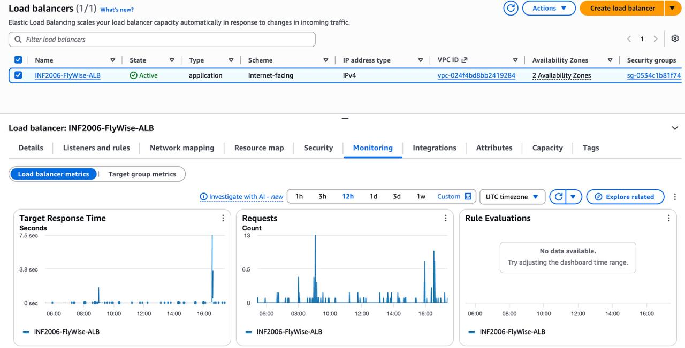
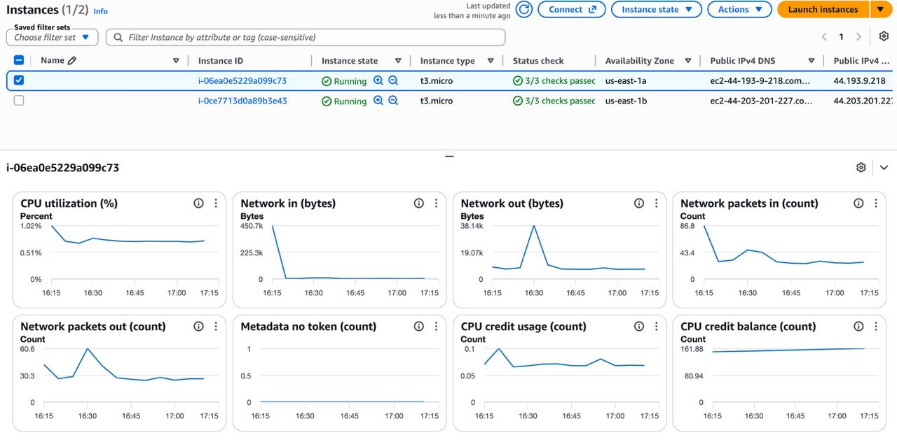
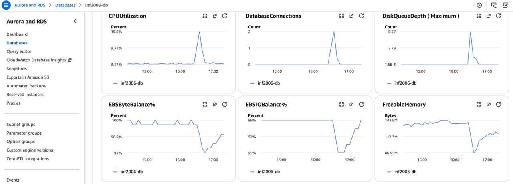
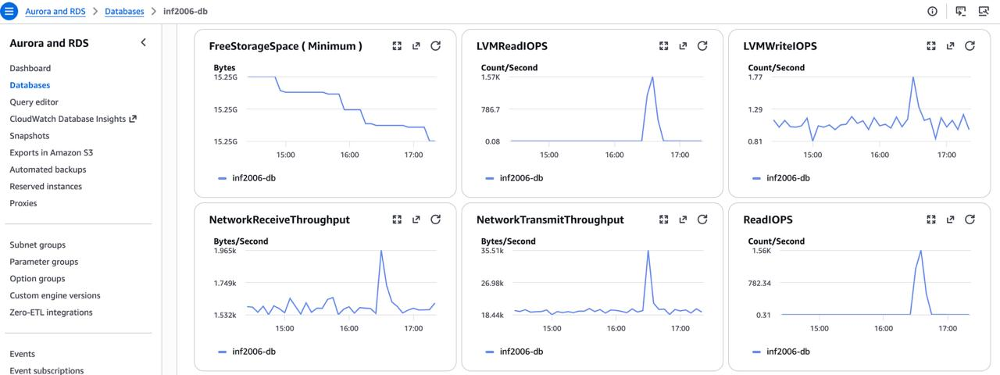

# Cloud Monitoring Evidence

This page collects the image evidence for monitoring the various AWS services used by FlyWise.

## Summary

| # | Evidence | Format | Link |
|---|----------|--------|------|
| 1 | Application Load Balancer (ALB) | Image | [🖼 View](./evidence_images/Monitoring/ALB.jpg) |
| 2 | EC2 Instance | Image | [🖼 View](./evidence_images/Monitoring/EC2.jpg) |
| 3 | RDS Metrics 1 | Image | [🖼 View](./evidence_images/Monitoring/RDS1.jpg) |
| 4 | RDS Metrics 2 | Image | [🖼 View](./evidence_images/Monitoring/RDS2.jpg) |
| 5 | Target Group | Image | [🖼 View](./evidence_images/Monitoring/Target%20Group.jpg) |

---

## Media files

### 1. Application Load Balancer (ALB)

---

### 2. EC2 Instance

---

### 3. RDS Metrics 1

---

### 4. RDS Metrics 2

---

### 5. Target Group

